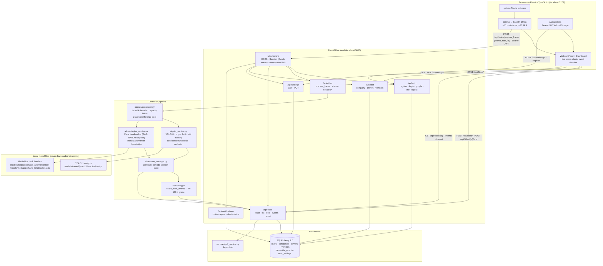

# DriverGuard AI

**Real-time driver monitoring that watches the cabin, not just the road.**

DriverGuard AI runs a live camera feed through a computer-vision pipeline to score how
safely a driver is behaving: a YOLO11 detector watches for phone and drink/food objects in
the cabin, MediaPipe face and hand landmarkers read eye closure, yawning and head pose,
and a single scoring function turns the resulting event timeline into a 0–100 safety score.
Rides, events and scores are persisted, so a finished ride can be reviewed afterwards and
exported as a PDF report.

> **Status.** This is an implemented, test-covered engineering project — not a commercial
> product. It is designed and verified for local development. It does **not** terminate TLS,
> does **not** revoke JWTs on sign-out, and is not hardened for an untrusted network.
> See [Known limitations](#15-known-limitations) before deploying it anywhere.

---

## Table of Contents

1. [Badges & Overview](#1-badges--overview)
2. [Key Features](#2-key-features)
3. [Screenshots](#3-screenshots)
4. [Architecture](#4-architecture)
5. [Technology Stack](#5-technology-stack)
6. [Prerequisites](#6-prerequisites)
7. [Installation & Startup (Windows)](#7-installation--startup-windows)
8. [Environment Variables](#8-environment-variables)
9. [Model Files](#9-model-files)
10. [User Flow: Register → Monitor → Summary](#10-user-flow-register--monitor--summary)
11. [API Overview](#11-api-overview)
12. [Project Structure](#12-project-structure)
13. [Testing, Build & Lint](#13-testing-build--lint)
14. [Troubleshooting](#14-troubleshooting)
15. [Known Limitations](#15-known-limitations)
16. [Privacy & Security Notes](#16-privacy--security-notes)
17. [Contributing, License & Support](#17-contributing-license--support)

---

## 1. Badges & Overview

<div align="center">


</div>

**What it is:** a full-stack web application with a React/TypeScript frontend and a
Python/FastAPI backend. The browser captures webcam frames from a `<video>` element onto a
`<canvas>`, encodes them as JPEG, and POSTs each frame to the backend over HTTP. The backend
decodes, runs YOLO11 and MediaPipe, applies temporal confirmation, scores the session, and
writes events to the database. The UI polls the session summary and renders the live score,
event timeline and alerts.

**What it is not:** it is not a dashcam, not a vehicle-control system, and not a substitute
for a certified driver-monitoring product. It makes no accuracy guarantees.

### Architecture at a glance

| Layer | Technology | Runs on |
| --- | --- | --- |
| Marketing + app UI | React 19, TypeScript, Tailwind CSS | Browser |
| Camera capture | `getUserMedia` → `<canvas>` → base64 JPEG | Browser |
| Transport | HTTP `POST /api/video/process_frame` (Bearer JWT) | Browser ↔ API |
| API | FastAPI + Uvicorn | `localhost:5000` |
| Detection | YOLO11 (Ultralytics) + MediaPipe Tasks Vision | CPU by default |
| Persistence | SQLAlchemy 2.0 over SQLite (or any SQLAlchemy URL) | `backend/` |
| Auth | bcrypt passwords + HS256 JWT (7-day) + optional Google OAuth | Backend |

---

## 2. Key Features

Every item below was verified by reading the source. Items that are **not** implemented are
listed in [Known limitations](#15-known-limitations) instead of being claimed here.

### Live monitoring

- **Live cabin monitoring** — the dashboard mounts a single `WebcamFeed` component
  (`frontend/src/components/dashboard/WebcamFeed.tsx`) that streams the webcam into a canvas
  and POSTs each captured frame to the backend.
- **Frame loop** — frames are posted on a ~50 ms interval (≈20 FPS). The backend's own
  rate limit for this endpoint is `2000/minute` specifically so a healthy feed is never cut
  off by the global default (`backend/app/rate_limit.py`).
- **Detection readiness** — `GET /api/video/status` reports whether the pipeline can run.
  The UI shows the warm-up state rather than an error, because model loading happens on a
  background thread after the server is already accepting requests.
- **Graceful unavailability** — if a model is missing or still warming, `process_frame`
  returns HTTP `503` with `reason` of `models_missing`, `warming_up` or `not_ready`. It never
  returns a score for a frame it did not analyse.

### Object detection (YOLO11)

- **Cabin object tracking** — `backend/app/ai/yolo_service.py` maps model class names to
  three categories: `phone`, `drink`, `food`, plus `person`.
  Monitored classes include `cell phone`; `bottle`, `cup`, `wine glass`; `bowl`, `sandwich`,
  `pizza`, `donut`, `cake`, `banana`, `apple`, `orange`, `hot dog`, `fork`, `knife`, `spoon`.
  Only classes actually present in the loaded model are enabled.
- **Confidence hysteresis** — a new track needs a higher confidence to be created
  (phone `0.40`, other cabin classes `0.35`) than to stay alive (phone `0.30`, other `0.20`),
  so a single weak frame cannot create or sustain an event.
- **IoU tracking** — greedy IoU matching at `0.3`, with class conflict resolution so a strong
  detection of a different object in the same box replaces the old track.
- **Occlusion carry-over** — an object covered by a hand stays tracked for up to 3 s, but
  stops counting as evidence for scoring after 1.5 s.
- **Temporal confirmation** — a track is only reported after `CONFIRM_MIN_HITS = 2` hits.
- **Per-session inference budget** — YOLO runs at most once every 250 ms per session
  (`YOLO_MIN_INTERVAL_MS`), while MediaPipe still runs on every frame.

### Face & hand landmarks (MediaPipe)

Verified cues and thresholds from `backend/app/ai/mediapipe_service.py`:

| Cue | Signal | Confirmation |
| --- | --- | --- |
| `eyes_closed` | Eye aspect ratio (EAR) below threshold | sustained 0.7 s |
| `drowsy` | EAR below threshold | sustained 1.5 s |
| `yawn` | Mouth aspect ratio (MAR) above threshold | sustained 1.5 s |
| `head_away` | Yaw beyond 20° | sustained 1.5 s |
| `head_down` | Pitch beyond 18° | sustained 1.5 s |
| `phone_call_suspected` | Phone present + ear-region contact | 2.5 s present / 1.0 s clear |

- **Face landmarker** — 468 facial landmarks; EAR and MAR are computed from landmark
  geometry, and head angles from a normalised nose/cheek/forehead/chin geometry.
- **Hand landmarker** — 21 landmarks per hand; hand bounding boxes are used for
  hand-proximity association, so a drink or snack only raises an event when it is actually
  held at a hand or brought to the mouth.
- **Partial availability** — the pipeline reports `face` and `hand` readiness separately.
  A missing hand landmarker does not stop object detection; a missing face landmarker does,
  because the face cues produce the score.

### Scoring, events and ride summaries

- **Single scoring function** — `backend/app/ai/scoring.py::score_from_events()` is the only
  source of both the live score and the final ride score, so they cannot disagree.
- **Penalty model** — each event costs a fixed confirmation penalty plus a per-second rate
  beyond a grace period:

| Event | On confirmation | Per second | Grace |
| --- | --- | --- | --- |
| `phone_use` | 10.0 | 1.0 | 0.0 s |
| `phone_call_suspected` | 5.0 | 0.5 | 0.0 s |
| `eyes_closed` | 10.0 | 2.0 | 1.0 s |
| `drowsy` | 10.0 | 2.0 | 1.0 s |
| `head_away` | 3.0 | 1.0 | 0.5 s |
| `head_down` | 3.0 | 1.0 | 0.5 s |
| `drinking_eating` | 4.0 | 1.0 | 1.0 s |
| `yawn` | 2.0 | 0.0 | 0.0 s |

- **Bounded recovery** — clean driving earns 1 point per 5 s, but only up to the
  *duration-billed* portion of the penalties charged. A ride that recorded an event can never
  be scored back to a clean 100/100.
- **Grades** — Excellent (≥90), Good (≥75), Fair (≥60), Poor (≥40), Critical (<40).
- **Event timeline** — a per-event-type breakdown (count, total seconds, points lost) plus a
  sampled score timeline (`SCORE_TIMELINE_INTERVAL_SECONDS = 5.0`, max 240 samples).
- **No fabricated reports** — a ride that never scored a frame has no report. The summary
  endpoint returns `null` and the PDF endpoint returns `409` rather than printing a
  clean-ride attestation for an unmeasured ride.
- **PDF report** — `GET /api/rides/{id}/report` streams a ReportLab PDF, rendered off the
  event loop. It is refused for a ride that is still in progress or was never scored.

### Workspaces, accounts and fleet

- **Authentication** — email + password registration and sign-in (bcrypt hashes), plus
  optional Google OAuth 2.0. Sessions are stateless HS256 JWTs valid for 7 days.
- **Personal workspace** — a personal ride has no company, driver or vehicle attached; it is
  owned by the account that started it.
- **Fleet workspace** — company → drivers → vehicles → rides, with full CRUD over
  `/api/fleet/*`, all scoped to the authenticated owner. Driver and vehicle records must
  belong to the same company before a ride may reference them.
- **Workspace selection** — Personal vs Business is a client-side preference stored in the
  browser. It selects which UI you see; it is **not** an access-control boundary. Real
  authorisation is enforced server-side against the authenticated account.
- **Settings persistence** — user settings are stored server-side via `/api/settings`.
- **Email notifications** — driver invitations, ride reports, safety alerts and custom mail,
  all requiring SMTP configuration. Without it the endpoints return `503`.

---

## 3. Screenshots

> **No screenshots are committed to this repository.** The only image asset in the repo is
> `frontend/src/assets/hero.png`, which is a landing-page background, not a UI capture.
> The placeholders below are intentionally left un-filled rather than pointing at image
> paths that do not exist.

| Screen | Route | Screenshot |
| --- | --- | --- |
| Landing page | `/` | _placeholder — not yet captured_ |
| Sign in / Register | `/login`, `/register` | _placeholder — not yet captured_ |
| Workspace selection | `/select-workspace` | _placeholder — not yet captured_ |
| Personal dashboard + live feed | `/personal/dashboard` | _placeholder — not yet captured_ |
| Business / fleet dashboard | `/business/dashboard` | _placeholder — not yet captured_ |
| Ride summary | `/personal/ride-summary` | _placeholder — not yet captured_ |

**To capture them:** start both servers, walk the flow in
[section 10](#10-user-flow-register--monitor--summary), and drop the captures into a
`docs/screenshots/` folder — then replace the placeholders above with relative image links.

---

## 4. Architecture

### Mermaid diagram



### Request lifecycle for one frame

1. `WebcamFeed` draws the current video frame to a canvas and encodes it as a base64 JPEG.
2. `POST /api/video/process_frame` arrives with a Bearer JWT and an optional `ride_id`.
3. The endpoint checks readiness first. Not ready → `503` with a reason, **before** the
   frame is decoded, so a caller never waits on a model that is not loaded.
4. `app/opencv/processor.py` decodes the frame and runs YOLO and MediaPipe across a
   two-worker inference pool under a capacity limiter.
5. YOLO updates session tracks; MediaPipe raises face/hand cues. Hand and mouth boxes feed
   back into YOLO so drink/food proximity can be judged.
6. Both streams merge into the session's event timeline in `session_manager.py`.
7. `score_from_events()` produces the live score, grade and breakdown.
8. Confirmed events are persisted against the active ride through `ride_service.py`.

### Data model

```
User ──owns──> Company ──has──> Driver, Vehicle
  │                │              │        │
  └──started──> Ride ────────────┴────────┘
                │
                ├──< RideEvent   (type, source: yolo | mediapipe,
                │                  timestamps, duration, confidence, scores, metadata)
                ├── start_location / end_location  (GPS)
                └── session_summary (final score, grade, breakdown, timeline)

User ──has──> UserSettings
```

Ride ownership is enforced on every ride read and write: `ride.user_id` must equal the
authenticated user id, and fleet ids sent by the client are re-authorised against the
caller's own companies before anything is written.

---

## 5. Technology Stack

### Backend — `backend/`

| Package | Version | Role |
| --- | --- | --- |
| Python | 3.13 (developed on 3.13.5) | Runtime |
| FastAPI | `0.115.6` | ASGI web framework |
| Uvicorn | `0.34.0` | ASGI server, `run.py` entry point |
| SQLAlchemy | `2.0.36` | ORM and engine |
| python-jose | `3.3.0` | JWT sign/verify (HS256) |
| Authlib | `1.4.1` | Google OAuth 2.0 |
| bcrypt | `4.3.0` | Password hashing |
| slowapi | `0.1.10` | Per-endpoint rate limiting |
| python-dotenv | `1.1.0` | `.env` loading |
| ultralytics | `>=8.3.0` | YOLO11 inference |
| torch | `>=2.0.0` | Inference backend |
| mediapipe | `>=0.10.30` | Face + hand landmarks |
| opencv-python | `4.10.0.84` | Frame decode and processing |
| numpy | `2.1.3` | Array handling |
| Pillow | `10.4.0` | Image handling |
| reportlab | `5.0.1` | PDF ride reports |
| email-validator | `2.1.0` | `EmailStr` payload validation |
| python-multipart | `0.0.12` | Form/file support |
| pyngrok | `>=7.0.0` | Listed in requirements; optional tunnel helper |
| httpx / requests | `0.27.2` / `2.32.3` | OAuth and test client |

### Frontend — `frontend/`

| Package | Version | Role |
| --- | --- | --- |
| React / React DOM | `19.2.7` | UI |
| TypeScript | `~6.0.2` | Type safety |
| Vite | `^8.1.1` | Dev server (port 5173) and build |
| Tailwind CSS | `^3.4.19` | Utility-first styling |
| react-router-dom | `^7.18.1` | Routing and route guards |
| framer-motion | `^12.42.2` | Animation and page transitions |
| lucide-react | `^1.27.0` | Icons |
| oxlint | `^1.71.0` | Linter (`npm run lint`) |
| @vitejs/plugin-react | `^6.0.3` | React fast refresh |

---

## 6. Prerequisites

| Requirement | Notes |
| --- | --- |
| **OS** | Windows 10 / 11 (instructions below). macOS and Linux work with the same commands minus the `Scripts\` path differences. |
| **Python** | 3.13.x. Check with `python --version`. |
| **Node.js** | 18+ (Vite 8 requires a modern Node). Check with `node --version`. |
| **npm** | Ships with Node. Check with `npm --version`. |
| **Webcam** | Required. Monitoring cannot run without camera access. |
| **Free disk** | ~3–5 GB for the Python environment (torch + ultralytics + mediapipe are large). |
| **RAM** | 4 GB minimum. 8 GB+ recommended — see [CPU performance](#15-known-limitations). |
| **GPU** | Optional. CUDA is used automatically if `torch.cuda.is_available()`; otherwise everything runs on CPU. |
| **Network** | Needed once for `pip install` and `npm install`, plus Google OAuth if you use it. **Models are never downloaded at runtime.** |

---

## 7. Installation & Startup (Windows)

### 7.1 Get the code

```powershell
git clone <your-repository-url> DDD
cd DDD
```

### 7.2 Backend

All backend commands run from the **`backend/`** directory.

```powershell
cd backend

# 1. Create and activate a virtual environment
python -m venv .venv
.\.venv\Scripts\Activate.ps1

# 2. Install dependencies (large: torch, ultralytics, opencv, mediapipe)
pip install --upgrade pip
pip install -r requirements.txt

# 3. Create the environment file
copy .env.example .env
```

Now edit `backend\.env` and set at least these four values — the app **refuses to start**
without the two secrets, and authentication needs the database URL:

```dotenv
SECRET_KEY=<generated>
JWT_SECRET=<generated>
DATABASE_URL=sqlite:///driverguard.db
GOOGLE_CLIENT_ID=
GOOGLE_CLIENT_SECRET=
```

Generate each secret with:

```powershell
python -c "import secrets; print(secrets.token_urlsafe(64))"
```

> Run the command twice and use **two different values**. `SECRET_KEY` signs the OAuth state
> cookie; `JWT_SECRET` signs access tokens.

Full variable reference: [section 8](#8-environment-variables).

```powershell
# 4. Verify the model files are present (downloads nothing)
.\.venv\Scripts\python.exe scripts\setup_models.py

# 5. Start the API on http://localhost:5000
python run.py
```

On the first start you should see the warm-up log. Models load on a **background thread**,
so the server accepts requests immediately; readiness is reported by `/api/video/status`.

Confirm it is up:

```powershell
curl.exe http://localhost:5000/api/health
# {"status":"online","service":"DriverGuard AI Python FastAPI","environment":"development"}
```

### 7.3 Frontend

All frontend commands run from the **`frontend/`** directory, in a separate terminal.

```powershell
cd frontend
npm install
npm run dev
```

Vite serves on **<http://localhost:5173>** and opens your browser automatically.
It reads the API base URL from `VITE_API_BASE_URL` (or `VITE_API_URL`), defaulting to
`http://localhost:5000` — which matches the backend default, so no `.env` is needed for a
standard local run.

### 7.4 Running both together

```powershell
# Terminal 1
cd backend
.\.venv\Scripts\Activate.ps1
python run.py

# Terminal 2
cd frontend
npm run dev
```

<details>
<summary>Running the backend against a different port</summary>

`backend/run.py` reads the `PORT` environment variable and defaults to `5000`. It binds
`0.0.0.0`, which exposes it on every network interface — for local work prefer starting
behind the Vite proxy or restricting the port yourself.

```powershell
$env:PORT = 5001
python run.py
```

If you change the port, also set `VITE_API_BASE_URL` for the frontend and add the origin to
the allowed list in `backend/app/__init__.py`.
</details>

---

## 8. Environment Variables

### Backend — `backend/.env`

Start from [`backend/.env.example`](backend/.env.example):

```powershell
cd backend
copy .env.example .env
```

`backend/.env` is gitignored. **Never commit it.** The file contains no real values below —
everything marked *required* must be filled in by you.

| Variable | Required | Default | Purpose |
| --- | :---: | --- | --- |
| `SECRET_KEY` | **Yes** | — | Signs the OAuth `state` cookie. No fallback; the app refuses to start. |
| `JWT_SECRET` | **Yes** | — | Signs and verifies access tokens (HS256). No fallback. |
| `DATABASE_URL` | **Yes for auth** | — | SQLAlchemy URL. `sqlite:///driverguard.db` is the local default to use. |
| `FLASK_ENV` | No | `development` | `development` or `production`; selects the config class. |
| `FLASK_DEBUG` | No | — | Present in `.env.example` for parity with the original Flask config. |
| `BACKEND_URL` | No | `http://localhost:5000` | Backend base URL. |
| `FRONTEND_URL` | No | `http://localhost:5173` | Comma-separated list of allowed CORS origins. |
| `PORT` | No | `5000` | Port for `run.py`. |
| `GOOGLE_CLIENT_ID` | For Google sign-in | — | OAuth 2.0 client id. |
| `GOOGLE_CLIENT_SECRET` | For Google sign-in | — | OAuth 2.0 client secret. |
| `GOOGLE_CALLBACK_URL` | No | `http://localhost:5000/api/auth/google/callback` | Must match the redirect URI registered with Google. |
| `YOLO_MODEL_PATH` | No | `models/trained/yolo11/detection/best.pt` | Resolved relative to `backend/`, never the working directory. |
| `FACE_TASK_PATH` | No | `models/mediapipe/face_landmarker.task` | Takes priority over `MEDIAPIPE_FACE_MODEL_PATH`. |
| `HAND_TASK_PATH` | No | `models/mediapipe/hand_landmarker.task` | Takes priority over `MEDIAPIPE_HAND_MODEL_PATH`. |
| `MEDIAPIPE_FACE_MODEL_PATH` | No | `models/mediapipe/face_landmarker.task` | Alias, used when `FACE_TASK_PATH` is unset. |
| `MEDIAPIPE_HAND_MODEL_PATH` | No | `models/mediapipe/hand_landmarker.task` | Alias, used when `HAND_TASK_PATH` is unset. |
| `YOLO_OFFLINE` | No | set to `true` at startup | Prevents Ultralytics from probing the network. Set automatically. |
| `SMTP_HOST` | For email | — | SMTP server. Notifications return `503` without it. |
| `SMTP_PORT` | No | `587` | SMTP port. |
| `SMTP_USER` | For email | — | SMTP username. |
| `SMTP_PASSWORD` | For email | — | SMTP password. |
| `SMTP_TLS` | No | `true` | STARTTLS on/off. |
| `SMTP_TIMEOUT` | No | `15` | SMTP timeout in seconds. |
| `FROM_EMAIL` | No | `noreply@driverguard.ai` | Sender address. |

> **Hard requirement, enforced in code.** `SECRET_KEY` and `JWT_SECRET` have no defaults and
> no placeholders. `backend/app/config.py::require_secret()` raises at import time if either
> is missing or still holds a known placeholder value. The test suite sets both itself, so
> tests never depend on your `.env`.

### Frontend — `frontend/.env` (optional)

Only needed if the API is not on `http://localhost:5000`:

```dotenv
VITE_API_BASE_URL=http://localhost:5000
```

`VITE_API_URL` is accepted as an alias. The value is read from Vite's env at build time —
restart `npm run dev` after changing it.

---

## 9. Model Files

Three local model files are required. **The backend never downloads anything** — a missing
file is reported, not fetched. `YOLO_OFFLINE` is set before the Ultralytics import
specifically so this backend makes no network calls at model load.

Check what is installed at any time:

```powershell
cd backend
python scripts\setup_models.py
```

| Model | Default path (relative to `backend/`) | Size | Committed to git? |
| --- | --- | --- | --- |
| YOLO11 detection weights | `models/trained/yolo11/detection/best.pt` | ~5.4 MB | **No** — `*.pt` is in `.gitignore` |
| MediaPipe face landmarker | `models/mediapipe/face_landmarker.task` | ~3.6 MB | Yes |
| MediaPipe hand landmarker | `models/mediapipe/hand_landmarker.task` | ~7.5 MB | Yes |

A file counts as installed only if it exists and is at least 1 MB, so a truncated download is
treated as missing.

### Obtaining the files

**MediaPipe `.task` bundles.** These are Google's official MediaPipe model files. This
repository records **no download URL** for them, so fetch them yourself from Google's
official MediaPipe model release and place them at the paths above. Confirm the names match
exactly — the loader looks for `face_landmarker.task` and `hand_landmarker.task`.

**YOLO11 weights.** Two legitimate routes:

1. **Use the checkpoint already produced by this project's training pipeline.** The
   training code lives in `backend/yolo11/` (`train.py`, `train_detect.py`,
   `prepare_subset.py`, `evaluate_detect.py`). See
   [`backend/yolo11/DATASET_REQUIREMENTS.md`](backend/yolo11/DATASET_REQUIREMENTS.md).
2. **Supply your own Ultralytics detection checkpoint.** Any object-detection `.pt` loads,
   as long as it is a `detect` task — the loader explicitly rejects a classification
   checkpoint. Class names are read from the model at load time and intersected with the
   monitored class list, so a model without `cell phone` simply never reports one.

### ⚠️ Important note about the bundled checkpoint

The `best.pt` present in this working tree was inspected and reports **the 80 COCO class
names** (`person`, `bicycle`, … `cell phone`, … `toothbrush`), i.e. a general COCO-pretrained
YOLO11 detection checkpoint — **not** the 5-class custom cabin model declared in
[`backend/yolo11/data.yaml`](backend/yolo11/data.yaml) (`person`, `mobile_phone`,
`bottle_cup`, `steering_wheel`, `seatbelt`).

Consequences to be aware of:

- The detector will run, and `cell phone`, `bottle`, `cup`, `wine glass`, `fork`, `knife`,
  `spoon`, `bowl`, `banana`, `apple`, `sandwich`, `orange`, `hot dog`, `pizza`, `donut` and
  `cake` are all present in that class list, so the phone and drink/food categories do work.
- It will **not** report `steering_wheel` or `seatbelt`, because those names are not in
  `CABIN_CLASS_CATEGORIES` at all — seat-belt detection is not implemented (see
  [limitations](#15-known-limitations)).
- Detection quality is generic COCO performance on cabin scenes, not cabin-tuned accuracy.

> **Needs manual confirmation:** whether this checkpoint is the intended deliverable or
> placeholder. If you want the custom cabin model, train it with `backend/yolo11/` on a
> bounding-box dataset as described in `DATASET_REQUIREMENTS.md`, then place the resulting
> `best.pt` at the path above.

---

## 10. User Flow: Register → Monitor → Summary

### 10.1 Register

1. Open <http://localhost:5173/register>.
2. Enter a name, email and password and submit. A company name is optional at this stage.
3. The account is written to the database (bcrypt-hashed password) and you receive a JWT,
   stored in the browser.
4. If you are already signed in, `/register` redirects you straight to your workspace.

### 10.2 Sign in

1. Open <http://localhost:5173/login> and enter your email and password.
2. On success you are redirected to `/select-workspace`, or straight to your dashboard if a
   workspace was already chosen.
3. **Optional:** use the Google sign-in button. This requires `GOOGLE_CLIENT_ID`,
   `GOOGLE_CLIENT_SECRET` and `GOOGLE_CALLBACK_URL` in `backend/.env`, plus a matching
   redirect URI registered in the Google Cloud console. Without them, skip this button.

### 10.3 Choose a workspace

At `/select-workspace` pick **Personal** or **Business**. This is a UI preference stored in
the browser, not a permission — the server enforces real access control separately.

- **Personal** → `/personal/dashboard`
- **Business** → `/business/dashboard`. If you have no company yet, create one first at
  `/business/company`, then add drivers (`/business/drivers/add`) and vehicles
  (`/business/vehicles/add`).

### 10.4 Start monitoring

1. On your dashboard, open the **Live Cabin Monitoring** panel. A fleet ride needs a driver
   *and* a vehicle from your fleet; a personal ride needs neither.
2. Click **Start Monitoring**. The frontend opens a ride with `POST /api/rides/` and attaches
   it to the monitoring session.
3. When the browser asks for camera permission, choose **Allow**.
4. The feed begins. Frames are captured, POSTed, analysed, and the live score, status badge,
   alerts and event timeline update. If the models are still warming, the panel says so
   instead of showing a false "safe".
5. Optional: the monitoring panel also shows GPS coordinates when you grant location
   permission. GPS points are stored on the ride, but see
   [limitations](#15-known-limitations) about distance and speed.

### 10.5 End the ride

1. Click **End Ride** in the monitoring toolbar.
2. A confirmation modal appears. Confirm.
3. The app stops the feed, closes every open event, freezes the session, writes the final
   score, grade, breakdown and timeline onto the ride row, and then releases the session.
4. You are redirected to `/personal/ride-summary?ride={id}` (or `/business/ride-summary?ride={id}`).
5. Ending a ride that scored no frames shows an explicit notice that there is no ride to
   report, rather than a perfect score.

### 10.6 View the summary

The ride summary page shows the final score and grade, the per-event-type breakdown, the
event timeline with timestamps and durations, ride duration, and GPS start/end points.
Download the PDF with the report action — it calls
`GET /api/rides/{id}/report`.

### 10.7 Return to the dashboard

Use the dashboard link in the navigation. The route is
`/personal/dashboard` or `/business/dashboard`, depending on your workspace.

<details>
<summary>Route reference (verified in <code>frontend/src/App.tsx</code>)</summary>

| Route | Page | Guard |
| --- | --- | --- |
| `/` | Landing | public |
| `/login`, `/register`, `/auth` | Auth | public (redirects if signed in) |
| `/select-workspace` | Workspace selection | authenticated |
| `/personal/dashboard` | Personal dashboard | `personal` |
| `/personal/monitoring` | Monitoring | `personal` |
| `/personal/ride-summary` | Ride summary | `personal` |
| `/personal/profile`, `/personal/settings` | Profile, settings | `personal` |
| `/business/dashboard`, `/business/drivers`, `/business/reports` | Fleet views | `business` |
| `/business/drivers/add`, `/business/vehicles/add` | Add driver / vehicle | `business` |
| `/business/monitoring`, `/business/ride-summary` | Monitoring, summary | `business` |
| `/business/company`, `/business/billing`, `/business/settings` | Company, billing, settings | `business` |
| `/dashboard`, `/monitoring`, `/profile`, `/settings` | Legacy redirects | authenticated |
| `*` | 404 | public |

`/enterprise` and `/company-setup` are permanent redirects to `/business/billing` and
`/business/company`.

</details>

---

## 11. API Overview

Base URL: `http://localhost:5000`. All endpoints except `/`, `/api/health` and the Google
OAuth entry point require `Authorization: Bearer <token>`.

Interactive API docs are available automatically while the server runs, because FastAPI
serves them: <http://localhost:5000/docs> (Swagger UI) and `/redoc`.

<details>
<summary><strong>Health</strong></summary>

| Method | Path | Auth | Purpose |
| --- | --- | :---: | --- |
| `GET` | `/` | No | Service banner with environment name |
| `GET` | `/api/health` | No | Unauthenticated liveness check |
</details>

<details>
<summary><strong>Authentication — <code>/api/auth</code></strong></summary>

| Method | Path | Auth | Purpose |
| --- | --- | :---: | --- |
| `POST` | `/api/auth/register` | No | Create an account, returns a JWT |
| `POST` | `/api/auth/login` | No | Sign in, returns a JWT |
| `GET` | `/api/auth/google` | No | Start the Google OAuth 2.0 flow |
| `GET` | `/api/auth/google/callback` | No | OAuth callback, exchanges the code |
| `GET` | `/api/auth/me` | Yes | Current user profile |
| `GET`/`POST` | `/api/auth/logout` | No | Client-side sign-out only — see [limitations](#15-known-limitations) |
</details>

<details>
<summary><strong>Live monitoring — <code>/api/video</code></strong></summary>

| Method | Path | Auth | Rate limit | Purpose |
| --- | --- | :---: | --- | --- |
| `POST` | `/api/video/process_frame` | Yes | 2000/min | Analyse one base64 JPEG frame; body `{ frame, ride_id? }` |
| `GET` | `/api/video/status` | Yes | 1200/min | Detection readiness: `ready`, `yolo`, `face`, `hand` |
| `POST` | `/api/video/session/reset` | Yes | default | Start a fresh in-memory session |
| `GET` | `/api/video/session/summary` | Yes | default | Active session summary (`null` when nothing was scored) |
| `POST` | `/api/video/session/set_ride` | Yes | default | Attach the session to a ride |
| `POST` | `/api/video/session/clear_ride` | Yes | default | Detach the ride from the session |
| `WS` | `/api/video/stream` | Yes | — | WebSocket stream handler. **The React frontend uses the HTTP frame endpoint, not this.** |

`process_frame` returns `503` with `reason` ∈ `models_missing` · `warming_up` · `not_ready`
when detection cannot run.

Rate limits: the global default is `100/minute`; login is `10/minute`; notifications are
`20/minute`.
</details>

<details>
<summary><strong>Rides — <code>/api/rides</code></strong></summary>

| Method | Path | Auth | Purpose |
| --- | --- | :---: | --- |
| `POST` | `/api/rides/` | Yes | Start a ride. Omit both ids for a personal ride; send `driver_id` + `vehicle_id` for a fleet ride. Optional `start_location`. |
| `GET` | `/api/rides/` | Yes | List the caller's rides |
| `GET` | `/api/rides/{ride_id}` | Yes | Ride detail |
| `POST` | `/api/rides/{ride_id}/end` | Yes | Finalize a ride, returns `session_summary`. Optional `end_location`. |
| `GET` | `/api/rides/{ride_id}/events` | Yes | Event timeline for a ride |
| `GET` | `/api/rides/{ride_id}/report` | Yes | PDF report. `409` if the ride is running or was never scored. |
</details>

<details>
<summary><strong>Fleet — <code>/api/fleet</code></strong></summary>

| Method | Path | Auth | Purpose |
| --- | --- | :---: | --- |
| `POST` | `/api/fleet/company` | Yes | Create the caller's company |
| `GET` | `/api/fleet/company` | Yes | Read the caller's company |
| `PUT` | `/api/fleet/company` | Yes | Update the company |
| `POST` | `/api/fleet/drivers` | Yes | Add a driver |
| `GET` | `/api/fleet/drivers?page=&page_size=` | Yes | List drivers, paginated |
| `GET` `PUT` `DELETE` | `/api/fleet/drivers/{driver_id}` | Yes | Read / update / delete a driver |
| `POST` | `/api/fleet/vehicles` | Yes | Add a vehicle |
| `GET` | `/api/fleet/vehicles?page=&page_size=` | Yes | List vehicles, paginated |
| `GET` `PUT` `DELETE` | `/api/fleet/vehicles/{vehicle_id}` | Yes | Read / update / delete a vehicle |

Every fleet route is scoped to the authenticated owner. Sending only `driver_id` or only
`vehicle_id` on ride start is refused, and both must resolve to the same company.
</details>

<details>
<summary><strong>Settings — <code>/api/settings</code></strong></summary>

| Method | Path | Auth | Purpose |
| --- | --- | :---: | --- |
| `GET` | `/api/settings/` | Yes | Read the caller's settings |
| `PUT` | `/api/settings/` | Yes | Update the caller's settings |
</details>

<details>
<summary><strong>Notifications — <code>/api/notifications</code></strong> (requires SMTP)</summary>

| Method | Path | Auth | Purpose |
| --- | --- | :---: | --- |
| `POST` | `/api/notifications/send` | Yes | Send a custom email |
| `POST` | `/api/notifications/invite-driver` | Yes | Send a driver invitation |
| `POST` | `/api/notifications/ride-report` | Yes | Email a ride report |
| `POST` | `/api/notifications/safety-alert` | Yes | Send a safety alert |
| `GET` | `/api/notifications/status` | Yes | Report whether email is configured |

Without SMTP configuration every send endpoint returns `503`.
</details>

<details>
<summary><strong>Example — analyse one frame</strong></summary>

```powershell
# 1. Sign in and capture the token (POST /api/auth/register accepts
#    {"name": ..., "company": ..., "email": ..., "password": ...})
$login = Invoke-RestMethod -Method Post -Uri http://localhost:5000/api/auth/login `
  -ContentType 'application/json' `
  -Body '{"email":"you@example.com","password":"your-password"}'
$token = $login.token

# 2. Send one frame (a tiny 1x1 JPEG is enough to see the response shape)
$frame = [Convert]::ToBase64String([IO.File]::ReadAllBytes("frame.jpg"))
$body = @{ frame = $frame } | ConvertTo-Json

Invoke-RestMethod -Method Post -Uri http://localhost:5000/api/video/process_frame `
  -Headers @{ Authorization = "Bearer $token" } `
  -ContentType 'application/json' -Body $body
```

</details>

---

## 12. Project Structure

```
DDD/
├── README.md                      # this file
├── VERIFICATION_REPORT.md         # prior internal verification pass
├── .gitignore
├── DOCS/                          # reference PDFs on MediaPipe & YOLOv11 distraction detection
├── animation/                     # decorative background videos used by the landing page
├── Data/                          # local dataset (gitignored)
├── runs/                          # local training output (gitignored)
├── yolo11_transfer/               # training transfer pack (gitignored)
│
├── backend/                       # Python / FastAPI
│   ├── run.py                     # entry point — uvicorn on 0.0.0.0:$PORT (default 5000)
│   ├── requirements.txt
│   ├── .env.example               # copy to .env; .env is gitignored
│   ├── app/
│   │   ├── __init__.py            # app factory, lifespan, model warm-up, CORS, routers
│   │   ├── config.py              # env loading, secret guards, model path resolution
│   │   ├── extensions.py          # SQLAlchemy engine/session, JWT key and lifetime
│   │   ├── rate_limit.py          # shared SlowAPI limiter and per-endpoint limits
│   │   ├── ai/
│   │   │   ├── yolo_service.py    # YOLO11 detection, tracking, cabin event mapping
│   │   │   ├── mediapipe_service.py # face + hand landmarks, EAR/MAR, head pose
│   │   │   ├── session_manager.py   # per-user/per-ride state and event timeline
│   │   │   └── scoring.py           # score_from_events — the single scoring function
│   │   ├── opencv/processor.py    # base64 decode, inference pool, capacity limiter
│   │   ├── camera/                # /api/video routes and WebSocket service
│   │   ├── auth/                  # /api/auth controller, service, routes, stores
│   │   ├── ride/                  # /api/rides routes
│   │   ├── fleet/                 # /api/fleet routes
│   │   ├── settings/              # /api/settings routes
│   │   ├── notifications/         # /api/notifications routes
│   │   ├── models/                # SQLAlchemy models: user, fleet, settings
│   │   ├── services/              # ride_service, settings_service, email_service, pdf_service
│   │   └── utils/                 # helpers
│   ├── models/
│   │   ├── mediapipe/*.task       # face + hand landmarkers (committed)
│   │   └── trained/               # YOLO weights (gitignored via *.pt)
│   ├── scripts/setup_models.py    # one-time model presence checker — downloads nothing
│   ├── tests/                     # 14 pytest modules
│   └── yolo11/                    # training pipeline + dataset config
│
└── frontend/                      # React / TypeScript / Vite
    ├── package.json               # dev · build (tsc -b && vite build) · lint (oxlint) · preview
    ├── vite.config.ts             # port 5173, @ alias, manual vendor chunks, sourcemaps
    ├── tailwind.config.js
    ├── index.html
    └── src/
        ├── main.tsx · App.tsx     # providers + all routes
        ├── pages/                  # Home, Auth, WorkspaceSelection, Dashboard, FleetDashboard,
        │                           # CompanySetup, AddDriver, AddVehicle, Monitor, RideSummary,
        │                           # Profile, Settings, Enterprise, NotFound
        ├── components/
        │   ├── Dashboard/          # Dashboard, BusinessDashboard, LiveMonitoringCenter, WebcamFeed
        │   ├── home/               # landing page sections
        │   ├── layout/             # Navbar, Footer, ThemeToggle
        │   ├── motion/             # animation helpers
        │   └── shared/             # Button, Card, SectionTitle, ProtectedRoute
        ├── layouts/                # MainLayout, DashboardLayout
        ├── context/                # AuthContext, ThemeContext, ToastContext
        ├── hooks/                  # use3DTilt, useGPS, useInView, useScrollY
        ├── services/               # authStorage, fleetApi, monitoringRide, sessionSummary,
        │                           # workspaceService
        ├── types/ · styles/ · assets/
        └── public/                 # driver-video.mp4, favicon.svg, icons.svg
```

---

## 13. Testing, Build & Lint

### Backend tests

`pytest` is **not** listed in `backend/requirements.txt` — install it once:

```powershell
cd backend
.\.venv\Scripts\Activate.ps1
pip install pytest

python -m pytest tests/ -q
```

The suite covers auth token expiry and malformed tokens, secret startup guards, per-endpoint
rate limiting, camera status auth and payload, ride lifecycle and tenant isolation, personal
rides, session isolation, scoring, notification tenant scoping, and settings integrity.
`tests/conftest.py` points `DATABASE_URL` at a throwaway SQLite file and generates fresh
`SECRET_KEY` / `JWT_SECRET` values per run, so tests never touch your development database
or `.env`.

Syntax check without running tests:

```powershell
python -m compileall -q app tests
```

<details>
<summary>Reported test results</summary>

[`VERIFICATION_REPORT.md`](VERIFICATION_REPORT.md) records **319 passed, 4 skipped** together
with a passing `compileall`, frontend build, `tsc --noEmit` and lint (0 errors, 5 pre-existing
warnings). **These results were not re-run while writing this README** — run the commands
above to confirm the current state on your machine.
</details>

### Frontend build, typecheck and lint

```powershell
cd frontend

npm run build          # tsc -b && vite build
npx tsc --noEmit      # typecheck only
npm run lint           # oxlint
npm run preview        # serve the production build locally
```

`npm run build` emits sourcemaps and splits vendor chunks (`router`, `motion`, `icons`,
`vendor`).

### Model presence check

```powershell
cd backend
python scripts\setup_models.py
```

Exits `0` when all three model files are present and plausibly sized, `1` otherwise, and
prints the exact path each missing file is expected at.

---

## 14. Troubleshooting

<details>
<summary><strong>The backend exits immediately with a <code>RuntimeError</code> about SECRET_KEY or JWT_SECRET</strong></summary>

Both are required and have no fallback. `backend/app/config.py::require_secret()` also rejects
known placeholder values, so copying `.env.example` unchanged will not work.

```powershell
# Generate two different values
python -c "import secrets; print(secrets.token_urlsafe(64))"
python -c "import secrets; print(secrets.token_urlsafe(64))"
```

Put one in `SECRET_KEY` and the other in `JWT_SECRET` in `backend/.env`.
</details>

<details>
<summary><strong><code>Database not configured</code> / login returns 500</strong></summary>

`DATABASE_URL` is unset or empty, so no SQLAlchemy engine was created. Set it in
`backend/.env`:

```dotenv
DATABASE_URL=sqlite:///driverguard.db
```

The database file is created relative to the process working directory. Start the server
from `backend/` to keep it predictable. Tables are created on first startup.
</details>

<details>
<summary><strong>Monitoring shows "Detection service unreachable" or a 503 with <code>reason: models_missing</code></strong></summary>

One or more model files are absent or under 1 MB. The response names the exact missing paths.
Run the checker:

```powershell
cd backend
python scripts\setup_models.py
```

Then place the files as described in [section 9](#9-model-files). The backend will never
download them for you.
</details>

<details>
<summary><strong>Monitoring stays on "warming up"</strong></summary>

Model loading happens on a background thread after startup, so this is normal for the first
while. Watch the backend console: it logs the torch thread count, the YOLO load result and
whether each MediaPipe landmarker loaded. The two chains run **sequentially** on purpose —
on a 4-core machine, running them concurrently roughly doubled both durations
(~14.7 s → ~28.9 s for YOLO, ~13.4 s → ~28.1 s for MediaPipe) because the heavyweight
imports contend for memory bandwidth and start paging. Poll
`GET /api/video/status` to watch progress.
</details>

<details>
<summary><strong>No phone or drink events, even though the objects are visible</strong></summary>

In order of likelihood:

1. **Class names.** YOLO reports only classes present in *your* checkpoint and present in
   `CABIN_CLASS_CATEGORIES`. The startup log prints
   `Monitored cabin classes: [...]` — check that list.
2. **Confidence.** A new phone track needs `0.40` and a new drink/food track `0.35`. A weak
   detection produces a candidate but no event.
3. **Temporal confirmation.** A track needs 2 hits before it is reported.
4. **Contact requirement.** A drink or snack only raises an event when it overlaps a hand box
   or the mouth box. An object sitting on the dashboard is a plain cabin object with no
   penalty — by design.
</details>

<details>
<summary><strong>The browser never asks for camera permission / the feed is black</strong></summary>

Camera access requires a secure context. `http://localhost` is treated as secure and works;
a LAN IP over plain HTTP will not. Check the browser's site-permission settings for
`localhost:5173`, and make sure another application is not holding the camera.
</details>

<details>
<summary><strong>CORS errors in the browser console</strong></summary>

`backend/app/__init__.py` allows `localhost:5173`, `localhost:5174`, `localhost:3000` and
`127.0.0.1:5173` / `:5174`, plus anything in `FRONTEND_URL`. If your frontend runs on
another port, add it there.
</details>

<details>
<summary><strong>429 Too Many Requests while monitoring</strong></summary>

`process_frame` is limited to `2000/minute` (≈33 FPS), which leaves headroom over the ~20 FPS
loop. If you run a second monitoring view in the same window, or a burst of reconnects,
you can hit it. `slowapi` state is in-process and per-worker, so limits do not coordinate
across multiple uvicorn workers.
</details>

<details>
<summary><strong>Google sign-in returns an error</strong></summary>

`GOOGLE_CLIENT_ID`, `GOOGLE_CLIENT_SECRET` and `GOOGLE_CALLBACK_URL` must be set, and the
callback URL must match a redirect URI registered in the Google Cloud console **exactly**.
The OAuth `state` CSRF value is carried in a session cookie signed with `SECRET_KEY`. Local
email/password sign-in is unaffected — use it if Google is not configured.
</details>

<details>
<summary><strong>Notification endpoints return 503</strong></summary>

No SMTP configuration. Set `SMTP_HOST`, `SMTP_USER`, `SMTP_PASSWORD` (and optionally
`SMTP_PORT`, `SMTP_TLS`, `FROM_EMAIL`) in `backend/.env`, then confirm with
`GET /api/notifications/status`. This path is not covered end-to-end by the automated suite.
</details>

<details>
<summary><strong><code>npm run dev</code> fails to resolve <code>@/…</code> imports</strong></summary>

The `@` alias is defined in `frontend/vite.config.ts`. Make sure you are running from
`frontend/` and that `tsconfig.app.json` has the matching `paths` entry. Re-run
`npm install` if `node_modules` is inconsistent.
</details>

<details>
<summary><strong><code>pip install -r requirements.txt</code> fails on torch or mediapipe</strong></summary>

These are large platform-specific wheels. Check that your Python version has a matching
wheel — the project is developed on Python 3.13. On a 32-bit or very old Python, wheels may
not exist. Installing torch separately first from the official PyTorch index often resolves
mediapipe resolution. This is a platform limitation, not a code defect.
</details>

<details>
<summary><strong>A ride ends but the summary says there is nothing to report</strong></summary>

Working as intended: no frame was scored into that ride, so there is no measurement. The
system refuses to fabricate a clean-ride report. Confirm the model files were present and
`/api/video/status` returned `ready: true` before monitoring began.
</details>

---

## 15. Known Limitations

### Performance (CPU-only)

- **Inference defaults to CPU.** `yolo_service.py` selects CUDA only when
  `torch.cuda.is_available()`. Expect markedly lower FPS on a CPU-only machine.
- **YOLO is budgeted to ~4 runs/second per session** (`YOLO_MIN_INTERVAL_MS = 250`), while
  MediaPipe runs on every frame. The UI measures and displays the actual achieved FPS.
- **Startup warm-up is significant.** The two model chains load sequentially. The comments
  in `app/__init__.py` record measured figures on a 4-core / ~2 GB-free machine; expect
  tens of seconds, longer on a loaded or low-memory machine.
- **Thread budget is bounded on purpose.** `configure_torch_threads()` runs before any
  inference, because an unbounded thread pool on a small CPU oversubscribes and slows down.
- **No published benchmark.** No accuracy, latency or FPS figures are claimed here, because
  none are measured and recorded in this repository.

### Not implemented

- ❌ **Seat-belt detection.** Requires custom model training. Also not in the monitored class
  list.
- ❌ **Forward-gaze estimation.** Requires an iris-landmark model.
- ❌ **Hands-on-wheel detection.** Requires a steering-wheel detection model.
- ❌ **Multi-camera streaming.** Would require WebRTC or multiple WebSocket connections.
- ❌ **Real-time multi-driver fleet view.** The fleet dashboard reads stored records; it does
  not broadcast live feeds from several drivers at once.
- ❌ **Distance and average speed.** GPS points are collected and stored on the ride, but
  `distance_km` and `average_speed_kmh` are never computed, so those PDF fields always read
  "Not Available".
- ❌ **Driver/vehicle assignment from the UI.** The selection is offered in the interface but
  the client does not currently send it.
- ❌ **Input validation breadth.** Pydantic validators are not applied across every endpoint.
- ❌ **TLS termination.** Not implemented in-app. See [Privacy & Security](#16-privacy--security-notes).
- ❌ **JWT revocation.** Sign-out is client-side only.
- ❌ **End-to-end tests.** No Playwright/Cypress coverage.
- ❌ **CI/CD.** No GitHub Actions workflow exists — the badges on this page are static, and
  nothing verifies the build automatically.
- ❌ **Monitoring / metrics.** No Prometheus instrumentation. `/api/health` exists but is
  not wired into any UI status indicator.

### Unverified

The following were reported in [`VERIFICATION_REPORT.md`](VERIFICATION_REPORT.md) as
requiring a running browser or an external service, and are **not** covered by the automated
suite: database table creation on real startup, the Google OAuth round trip, company/driver/
vehicle CRUD through the UI, browser-side PDF download, GPS capture (needs browser
permission), the email service (needs SMTP), YOLO/MediaPipe detection (needs model files),
and TLS termination.

---

## 16. Privacy & Security Notes

Driver monitoring processes images of the person driving. Treat the following as real
constraints, not boilerplate.

**What leaves the machine.** Camera frames are POSTed to your own backend, which runs on
`localhost`. Frames are not persisted to disk — only derived events, scores and GPS points
are stored. There is no third-party analytics, no telemetry and no cloud inference.

**Transport.** `backend/run.py` binds plain HTTP on `0.0.0.0` and does **not** terminate
TLS. Bearer tokens and camera frames cross that hop in clear text unless you put a
TLS-terminating reverse proxy in front of it:

```text
nginx → https://your.domain → http://127.0.0.1:5000
```

`run.py` binds `0.0.0.0` by default, so on a shared or untrusted network the service is
reachable directly. Restrict the port or front it with a proxy.

**Secrets.** `SECRET_KEY` and `JWT_SECRET` are mandatory and have no fallback; the app
refuses to start without them and refuses to start if either still holds a value that ships
in the source tree. Use two different random values. `.env` is gitignored — never commit it.
No credentials of any kind are present in this repository.

**Passwords.** Hashed with bcrypt. Never stored or logged in plain text.

**Tokens.** HS256, valid for **7 days**, with **no revocation list**. Signing out clears the
token client-side only; a copied token stays valid until it expires. There is no application
layer encryption beyond TLS.

**Authorisation.** Real access control is enforced server-side against the authenticated
account: ride reads and writes check `ride.user_id`, and fleet identifiers sent by the
client are re-authorised against the caller's own companies before anything is written.
Workspace (Personal/Business) selection is a client-side UI preference and is **not** a
security boundary.

**Rate limiting.** `slowapi` limits are in-process and per-worker. Login is capped at
`10/minute`, the frame endpoint at `2000/minute`. Behind multiple workers or multiple
processes, limits do not add up — a shared store would be required.

**Consent.** Because this system infers drowsiness and distraction, obtain the driver's
consent before recording, tell them how long footage-derived data is retained, and provide a
way to stop monitoring. Retention of rides and events is not automated here — deletion is a
manual database operation.

---

## 17. Contributing, License & Support

### Contributing

No `CONTRIBUTING.md` and no automated contribution policy exist in this repository yet, so
none is invented here. If you want to propose one, that is a welcome pull request.

In the meantime, these conventions are observable in the codebase and worth matching:

- **Backend.** Modules are documented with a docstring that explains *why*, not just *what*.
  Public functions carry type hints. Secrets are read through
  `app.config.require_secret()` and never given a fallback.
- **Frontend.** TypeScript throughout, `@/` path alias for imports, page-level `lazy()`
  loading, and hooks in `src/hooks` rather than inline in components.
- **Tests.** Add to `backend/tests/` and keep them hermetic — `conftest.py` already isolates
  the database and generates per-run secrets. Run `python -m pytest tests/ -q` before opening
  a PR.
- **Before submitting.** `python -m pytest tests/ -q`, `python -m compileall -q app tests`,
  `npx tsc --noEmit`, and `npm run lint`.
- **Do not commit.** Model weights (`*.pt`), `.env`, `Data/`, `runs/`, and
  `yolo11_transfer/` are all gitignored. Do not add them.

### License

**No license file is present in this repository.** Without one, the default copyright rules
apply: no permission is granted to use, copy, modify or distribute this code. If you intend
to reuse it, add a `LICENSE` file first — that decision belongs to the copyright holder, so
it is not guessed at here.

### Support and contact

No support channel, email address, issue tracker link or maintainer contact is defined in
this repository, so none is fabricated here. For now:

- **Setup problems** — work through [Troubleshooting](#14-troubleshooting) and check
  `python scripts/setup_models.py` output first; the single most common cause is a missing
  model file or an unset `SECRET_KEY` / `JWT_SECRET` / `DATABASE_URL`.
- **Architecture questions** — see the diagram in [section 4](#4-architecture) and the
  module docstrings under `backend/app/`, which document the reasoning behind each pipeline
  decision in detail.
- **Prior verification state** — [`VERIFICATION_REPORT.md`](VERIFICATION_REPORT.md) records
  what was tested, what was manually verified, and what remains open.

---

<div align="center">

**DriverGuard AI** — live cabin monitoring, event-based safety scoring, and fleet ride
records, built with FastAPI, React, YOLO11 and MediaPipe.

</div>
